<p align="center">
  <a href="https://tenantwarden.org"></a>
</p>

<h1 align="center">TenantWarden</h1>

<p align="center">
  <b>Self-hosted security monitoring for Microsoft 365 and the servers behind it.</b>
</p>

<p align="center">
  <a href="https://tenantwarden.org"><b>tenantwarden.org</b></a> ·
  <a href="#quickstart">Quickstart</a> ·
  <a href="#screenshots">Screenshots</a> ·
  <a href="docs/AGENT.md">Agent guide</a> ·
  <a href="LICENSE">MIT licence</a>
</p>

<p align="center">
  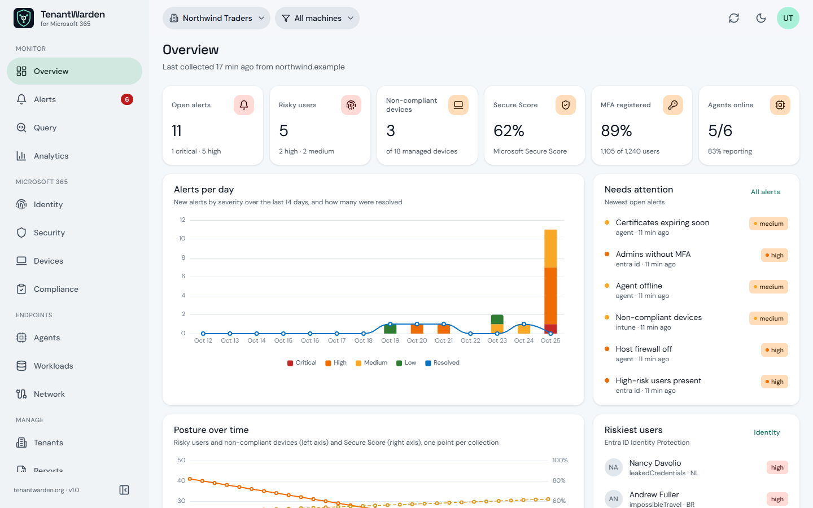
</p>

TenantWarden connects to your Microsoft 365 tenants through Microsoft Graph and watches identity risk,
sign-ins, MFA coverage, Conditional Access, device compliance, Secure Score, Defender XDR incidents and
service health. A small Go agent adds your Windows, Linux and macOS hosts: metrics, security events, server
roles such as SQL Server and Active Directory, their logs, and a patch/encryption/firewall inventory.
Everything lands in one dashboard, with alert rules, a query language, notifications, compliance scoring and
reports. It runs on your own infrastructure with Docker Compose and handles several tenants from one install.

Project website, with the latest on the project: **[tenantwarden.org](https://tenantwarden.org)**.
Created and maintained by **Junaid Ahmed**.

### Why TenantWarden

- **One place for the cloud and the servers.** Entra ID risk, Defender incidents and Intune compliance sit next to
  the SQL Server that just logged 14 failed logins and the web server whose health check started failing.
- **Your data stays with you.** Everything runs on your own hardware or cloud account and tenant secrets are encrypted
  at rest. Nothing leaves it except the Microsoft Graph calls and the notifications you configure.
- **Built for more than one tenant.** MSPs and groups with several Microsoft 365 tenants switch between them from the
  top bar; every user sees only the tenant they are allowed to.
- **Open and scriptable.** MIT licensed, a REST API for every feature, and a KQL-style query language that turns any
  question into an alert rule.

---

## What it does

| Area | What you get |
| --- | --- |
| **Tenants** | Connect Microsoft 365 tenants from the portal; client secrets are AES-256-GCM encrypted at rest. Choose which modules to collect, pause, edit or remove a tenant. |
| **Collection** | Every 15 minutes (or on demand): risky users and sign-ins, MFA registration, Conditional Access, Intune devices, Secure Score, Defender XDR incidents, service health, directory user count. A missing licence or permission skips that dataset only. |
| **Identity** | Risky users with **response actions in Entra ID**: dismiss risk, confirm compromised, revoke sessions. Sign-in risk trend, countries, MFA methods for everyone and for admins. |
| **Alerts** | 40 built-in metrics across identity, security, devices, hosts, network and server roles, a **rule library** of 50 ready-made rules, and **custom query rules** — any query can become an alert (each group of a `summarize … by` is checked separately). 15 default rules per tenant, cooldowns, de-duplication, alerts that close themselves when the condition clears, plus alerts from Defender incidents and critical agent events. Acknowledge (with comment), assign, resolve. |
| **Query** | A KQL-style language over agent events, hosts, server roles, endpoint checks, alerts, sign-ins, risky users, devices, incidents and the audit log: `AgentEvents \| where level == "error" \| summarize count() by bin(occurred_at, 1h), hostname`. Results as a table or chart, CSV export, one click to an alert rule. Read-only, tenant-scoped, time-limited. |
| **Notifications** | Microsoft Teams, Slack, email, webhooks, PagerDuty, ServiceNow and Jira, each with a minimum severity and a test button. |
| **Endpoint agent** | One command installs it as a Windows service or systemd unit. Streams CPU/memory/disk, the Windows Event Log or systemd journal (with brute-force detection), and an inventory: pending updates, BitLocker/LUKS/FileVault, firewall, Defender, SSH settings, admins, listening ports, installed software, certificates. |
| **Custom logs** | Watch any log file (glob, include/exclude regex, level detection), extra Windows event channels or journal units — set once in the portal's monitoring profile and pushed to every agent, or per host in `agent.yaml`. |
| **Workloads** | Agents discover SQL Server (instances, edition, port, SQL Agent), IIS, Active Directory, DNS, DHCP, Hyper-V, nginx, Apache, MySQL, PostgreSQL, Redis, MongoDB, Docker and more, collect their logs (SQL Server failed logins and I/O errors, nginx/Apache/MySQL/PostgreSQL error logs …) and show a dashboard per role. |
| **Network** | Throughput per host and fleet-wide, TCP connections, risky ports open to all interfaces, and TCP / HTTP / DNS endpoint checks run from inside your network with latency history and certificate expiry. |
| **Machine groups** | Group hosts in the portal (SQL servers, Production, London …), filter the fleet by status, platform and group, and pick a group or individual machines in the top bar: Agents, Workloads and Network — including the role-log charts — follow that selection. |
| **Analytics & compliance** | Period-over-period KPIs, mean time to acknowledge/resolve, alert sources, z-score anomaly detection on risky users; ISO 27001, NIST CSF and SOC 2 controls scored from live signals, with history. |
| **Reports** | Executive summary (print to PDF), CSV exports of alerts, risky users, devices, agents and the audit log, and a full JSON snapshot. |
| **Platform** | Role-based access (9 roles) with strict tenant isolation, local accounts with TOTP two-step sign-in and forced password change, 15-minute access tokens with rotating refresh tokens, per-user API keys, an audit log of every change, configurable data retention, light and dark theme in the tenantwarden.org palette. |

---

## Screenshots

<sub>All screenshots use a synthetic demo tenant, “Northwind Traders”. No real customer data.</sub>

<table>
  <tr>
    <td width="50%" valign="top">
      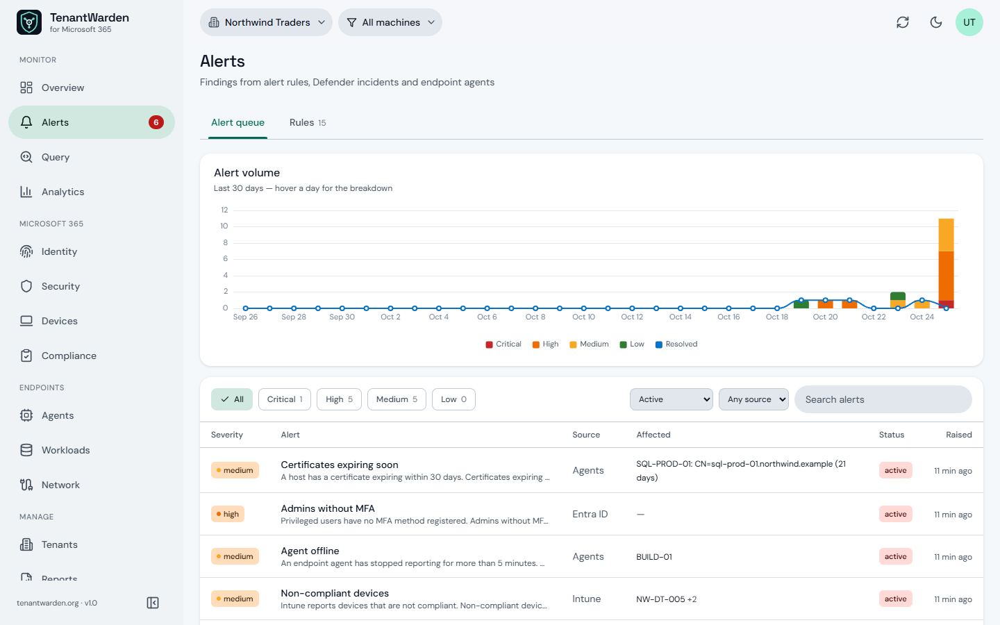
      <br><b>Alerts</b> — one queue for rule, Defender and agent alerts, with a 30-day trend, severity and source
      filters, acknowledge with a comment, assign and resolve.
    </td>
    <td width="50%" valign="top">
      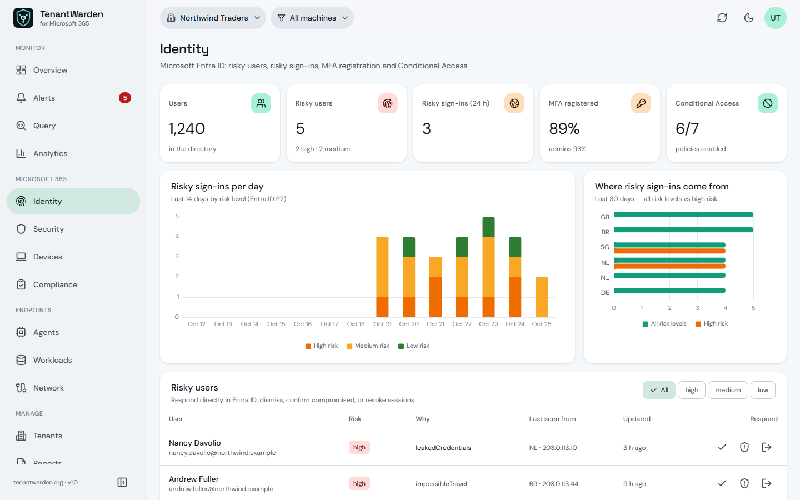
      <br><b>Identity</b> — risky sign-ins by day and country, MFA coverage, Conditional Access, and risky users you can
      dismiss, confirm compromised or sign out of every session from here.
    </td>
  </tr>
  <tr>
    <td valign="top">
      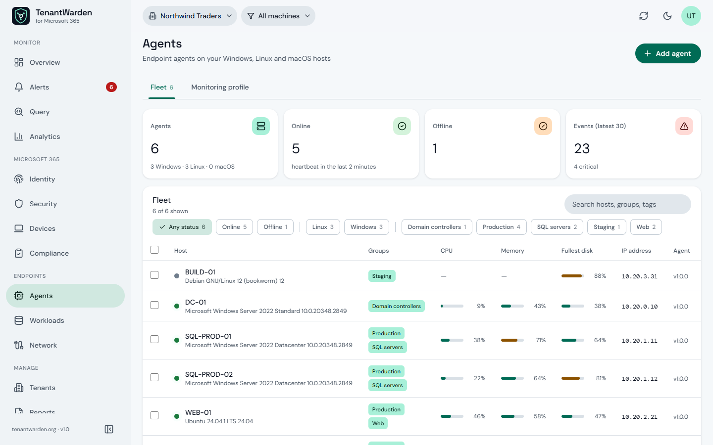
      <br><b>Agents</b> — the fleet at a glance: live status, CPU, memory, fullest disk, portal groups, and filters by
      status, platform and group. Select hosts to group them.
    </td>
    <td valign="top">
      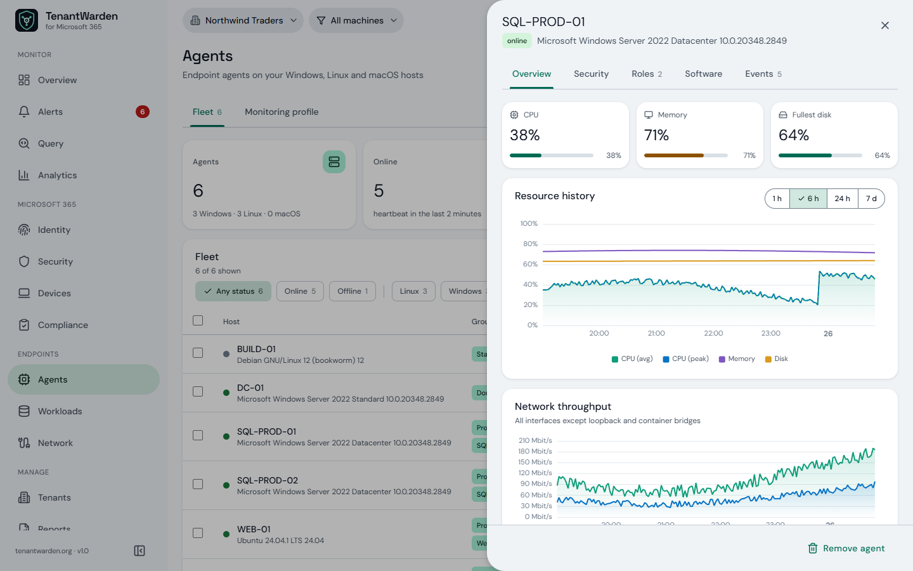
      <br><b>Host details</b> — resource and network history from ClickHouse, a security checklist (updates, BitLocker,
      firewall, Defender, SSH), discovered roles, certificates, software and events.
    </td>
  </tr>
  <tr>
    <td valign="top">
      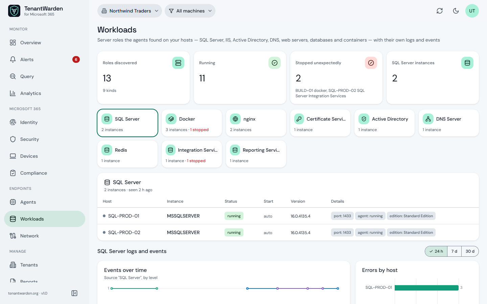
      <br><b>Workloads</b> — every server role the agents found, what stopped unexpectedly, and per-role log charts:
      SQL Server failed logins and I/O errors, nginx upstream errors, directory service warnings.
    </td>
    <td valign="top">
      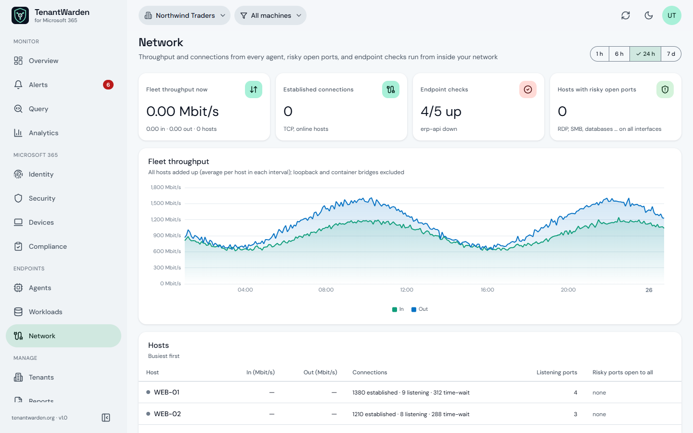
      <br><b>Network</b> — fleet throughput, connections per host, risky ports open to all interfaces, and HTTP / TCP /
      DNS checks run from inside your network.
    </td>
  </tr>
  <tr>
    <td valign="top">
      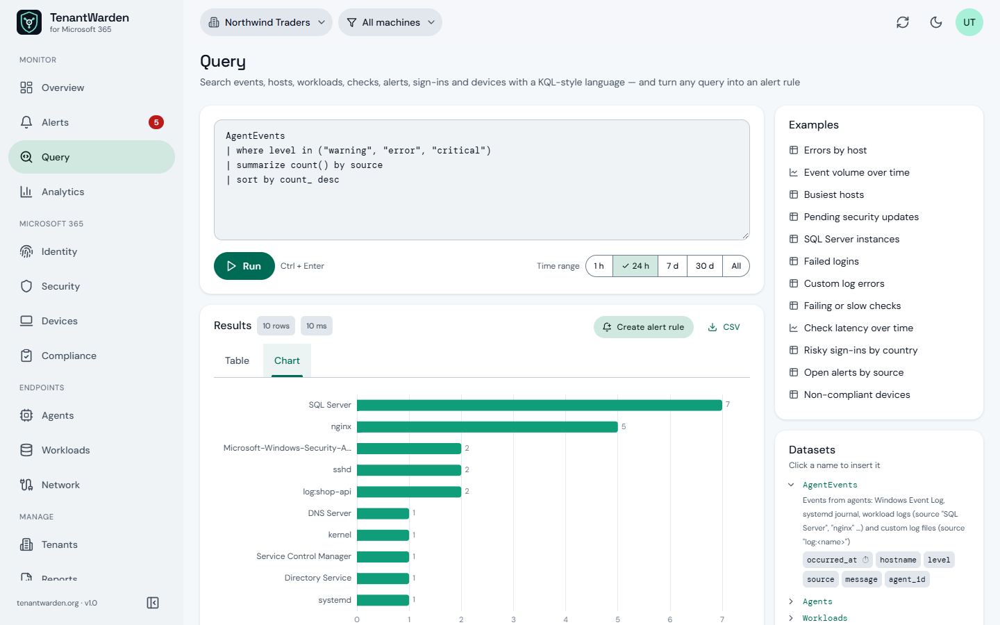
      <br><b>Query</b> — a KQL-style language over events, hosts, roles, checks, alerts, sign-ins and devices. Table or
      chart, CSV export, and <i>Create alert rule</i> from any result.
    </td>
    <td valign="top">
      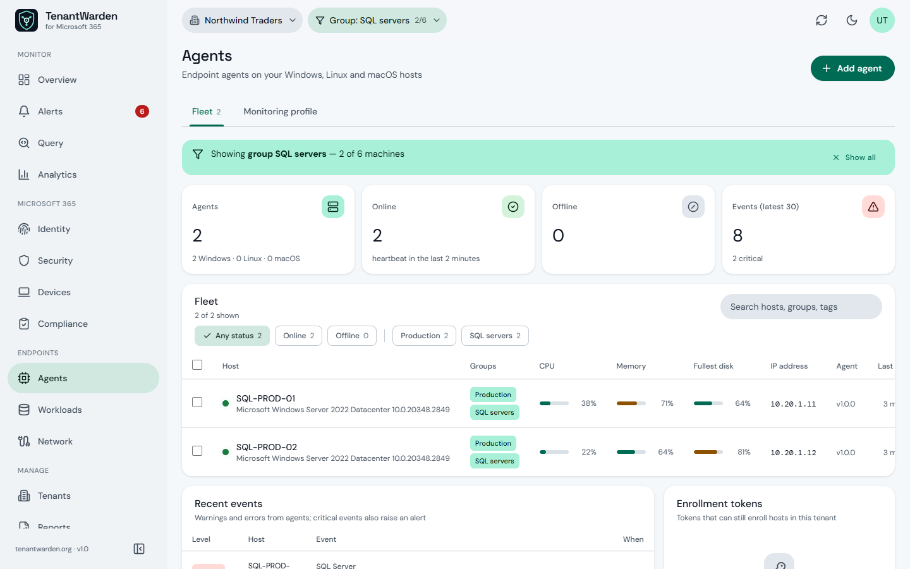
      <br><b>Machine scope</b> — pick a group or hand-pick machines in the top bar; every endpoint page follows, and a
      banner makes it obvious you are looking at a subset.
    </td>
  </tr>
  <tr>
    <td valign="top">
      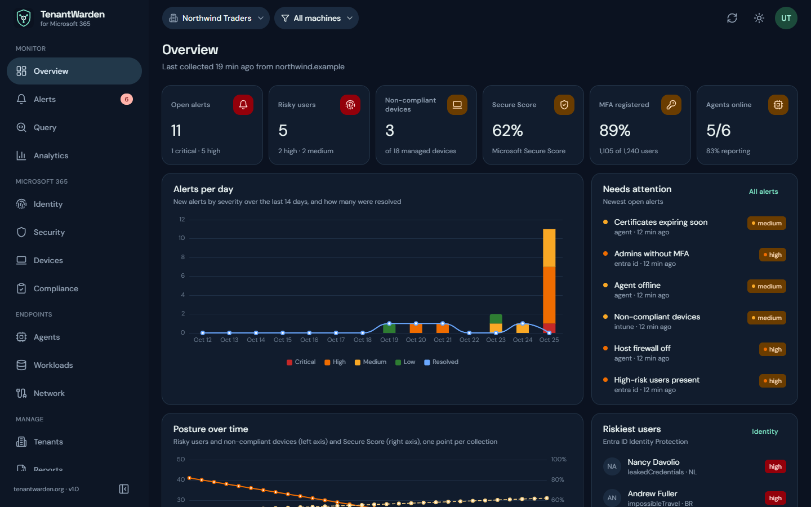
      <br><b>Dark theme</b> — the navy and mint of <a href="https://tenantwarden.org">tenantwarden.org</a>, with
      hairline panels instead of shadows.
    </td>
    <td valign="top">
      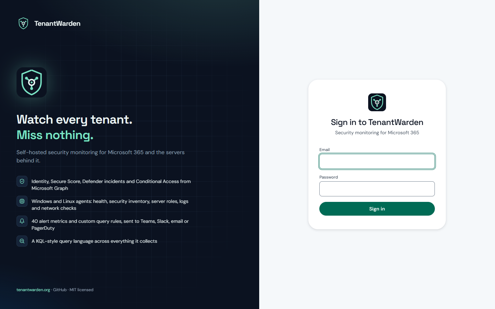
      <br><b>Sign-in</b> — local accounts with TOTP two-step sign-in; Entra ID single sign-on is on the
      <a href="TASK.md">roadmap</a>.
    </td>
  </tr>
</table>

---

## Quickstart

**You need:** Docker Engine 24+ with Compose v2, Python 3 and OpenSSL for the setup scripts.

```bash
git clone https://github.com/jahmed-cloud/TenantWarden.git
cd TenantWarden

make setup-env    # writes .env with fresh random secrets
make certs        # development TLS certificates
make build        # builds the images in sequential batches
make build-agent  # agent binaries for /downloads (uses Docker if Go isn't installed)
make up
```

Open **http://localhost:8090** and sign in with the default admin, `admin@tenantwarden.local` /
`TenantWarden!`. You choose a new password on first sign-in. If port 8090 or 8443 is taken, set
`GATEWAY_HTTP_PORT` / `GATEWAY_HTTPS_PORT` in `.env`.

Then:

1. **Tenants → Connect tenant.** Register an app in Microsoft Entra ID, grant the permissions below with
   admin consent, and paste the tenant ID, client ID and secret. The first collection starts straight away.
2. **Agents → Add agent.** Pick the platform, create an enrollment token and run the command it shows.
3. **Admin → Notifications.** Add a Teams, Slack or email channel and press **Test**.

Want to look around first? `make demo-data` loads a placeholder tenant with sample alerts. Don't run it on
an install with real tenants connected.

### Microsoft Graph permissions (application)

| Permission | Used for |
| --- | --- |
| `User.Read.All` | Directory user count |
| `IdentityRiskyUser.Read.All` | Risky users (Entra ID P2) |
| `AuditLog.Read.All` | Risky sign-ins, MFA registration report |
| `Policy.Read.All` | Conditional Access policies |
| `DeviceManagementManagedDevices.Read.All` | Intune devices and compliance |
| `SecurityEvents.Read.All` | Microsoft Secure Score |
| `SecurityIncident.Read.All` | Defender XDR incidents |
| `ServiceHealth.Read.All` | Microsoft 365 service health |
| `IdentityRiskyUser.ReadWrite.All` | *Optional:* dismiss risk / confirm compromised |
| `User.RevokeSessions.All` | *Optional:* revoke a user's sessions |

Without the two optional permissions everything is read-only; the response buttons report the Graph error.

---

## Endpoint agent

The agent is a single static binary for Windows, Linux (amd64/arm64) and macOS (Intel/Apple silicon).
`make build-agent` puts the binaries and their `SHA256SUMS` in `agent/dist/`, which the portal serves at
`/downloads/`. **Agents → Add agent** creates an enrollment token and shows the exact command, for example:

```bash
# Linux — installs and starts a systemd service
curl -fsSLo tenantwarden-agent https://portal.example.com/downloads/tenantwarden-agent-linux-amd64
chmod +x tenantwarden-agent
sudo ./tenantwarden-agent register --gateway-url wss://portal.example.com/agent --agent-token <token> --install
```

```powershell
# Windows — elevated PowerShell; installs the TenantWardenAgent service
.\tenantwarden-agent.exe register --gateway-url "wss://portal.example.com/agent" --agent-token "<token>" --install
```

`register` checks the token and the connection before it writes anything; `--tags sql,prod` labels the host for
monitoring-profile targeting. Custom log files, extra event channels and endpoint checks are set under
**Agents → Monitoring profile**. Other commands: `status`
(configuration and a live connection test), `start` (foreground), `install` / `uninstall`, `version`.
With self-signed certificates add `--ca-file ca.crt` (the portal serves the dev CA at `/downloads/ca.crt`).
Full guide: [docs/AGENT.md](docs/AGENT.md).

---

## Architecture

```
Browser ──► gateway (nginx: TLS, routing, rate limiting)
              ├── /         frontend        React + TypeScript, Material-style UI
              ├── /auth/    auth-service    ASP.NET Core 9: sign-in, TOTP, JWT, users, API keys
              ├── /api/     api             ASP.NET Core 9: REST API, audit log, agent telemetry consumer
              ├── /agent/ws agent-gateway   token-authenticated WebSocket hub  ◄── agents
              └── /downloads/               agent binaries

collector-service ──(Microsoft Graph)──► PostgreSQL ◄── alert-engine · analytics-engine · scheduler
agent-gateway ──Redis pub/sub──► api ──► PostgreSQL (agents, events) + ClickHouse (metric history)
alert-engine / collector / api ──Redis "tenantwarden:alerts"──► notification-service ──► Teams, Slack, …
```

| Service | Tech | Port | Purpose |
| --- | --- | --- | --- |
| `gateway` | nginx | 8090 / 8443 on the host | TLS, routing, rate limiting, `/downloads` |
| `frontend` | React + TS + Vite | 3000 | Dashboard |
| `api` | ASP.NET Core 9 | 8080 | REST API, audit log, agent telemetry consumer |
| `auth-service` | ASP.NET Core 9 | 8081 | Sign-in, TOTP, tokens, user admin, API keys |
| `agent-gateway` | ASP.NET Core 9 | 8082 / 4433 | Agent WebSocket hub |
| `collector-service` | Node.js + TS | 3001 | Microsoft Graph collection and response actions |
| `alert-engine` | Node.js + TS | 3002 | Rule evaluation every minute, metric catalogue, query engine |
| `notification-service` | Node.js + TS | 3003 | Notification dispatch |
| `analytics-engine` | Node.js + TS | 3004 | Compliance scoring, anomaly detection, retention |
| `scheduler` | Node.js + TS | 3006 | Housekeeping (agent status, old alerts, audit partitions) |
| `postgres` / `redis` / `clickhouse` | — | 5432 / 6379 / 8123 | Data stores |

---

## API access

Every portal feature is a REST endpoint under `/api/v1`. Create a personal key under
**Admin → API access** and send it as `X-API-Key`; it acts with your role and tenant:

```bash
curl -H "X-API-Key: twk_…" "https://portal.example.com/api/v1/alerts?tenantId=<id>&status=active"
```

---

## Development

```bash
make dev-api        # data stores in Docker, the API with dotnet watch
make dev-frontend   # the frontend with hot reload
```

Checks before a pull request: frontend `npm run build`, Node services `npx tsc --noEmit`, .NET services
`dotnet build`, agent `go vet ./...` (for Linux, Windows and macOS). No local .NET or Go? Run them in the
`mcr.microsoft.com/dotnet/sdk:9.0` and `golang:1.22` images. If Docker Desktop drops a build with
`error reading from server: EOF`, too many images are building at once: `make build` builds in batches.

**Production TLS:** `./scripts/setup-tls.sh tenantwarden.yourdomain.com you@example.com` (Let's Encrypt),
then `docker compose restart gateway`.

---

## Status

The Microsoft 365 collection, identity response actions, alerting, notifications, endpoint agent,
compliance, reports and access control work end to end. Still open: Microsoft Entra single sign-on for the
portal, mutual TLS for agents, the plugin engine, the Helm chart and automated tests. The default security
posture suits a private network or VPN. [TASK.md](TASK.md) tracks the work and
[SECURITY_AUDIT.md](SECURITY_AUDIT.md) the security review.

---

## About

TenantWarden is designed, built and maintained by **Junaid Ahmed**
([@jahmed-cloud](https://github.com/jahmed-cloud)).

- Website: **[tenantwarden.org](https://tenantwarden.org)**
- Questions, bugs and ideas: [open an issue](https://github.com/jahmed-cloud/TenantWarden/issues)
- Security reports: follow [SECURITY.md](SECURITY.md) rather than opening a public issue
- Contributing: [CONTRIBUTING.md](CONTRIBUTING.md)

## License

[MIT](LICENSE) © 2026 Junaid Ahmed
